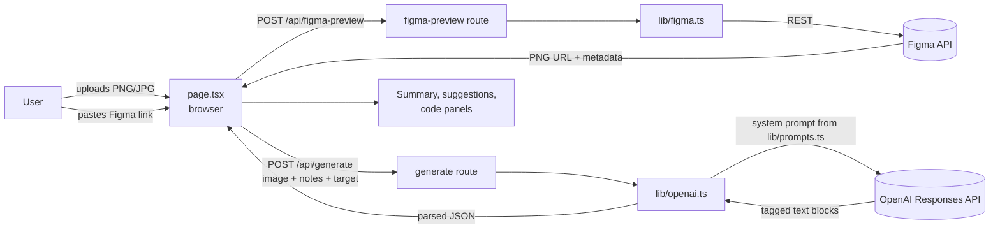

# AI Design-to-Code Generator

A Next.js app that turns a UI screenshot or a Figma frame into frontend code using a vision-capable AI model.
You give it a design, pick an output format (**React + Tailwind** or **HTML + CSS**), add optional instructions,
and it returns component code, CSS, responsive-design suggestions and the assumptions the model made.

This README explains **how the project works internally**, so you can read the code with a map in hand.

---

## Contents

1. [Tech stack](#tech-stack)
2. [Getting started](#getting-started)
3. [How it works (big picture)](#how-it-works-big-picture)
4. [Request lifecycle, step by step](#request-lifecycle-step-by-step)
5. [Code walkthrough, file by file](#code-walkthrough-file-by-file)
6. [The prompt contract](#the-prompt-contract)
7. [API reference](#api-reference)
8. [Error handling](#error-handling)
9. [Design decisions and limitations](#design-decisions-and-limitations)

---

## Tech stack

| Layer | Choice | Why |
|---|---|---|
| Framework | Next.js 15 (App Router) | UI and API routes in one project; API keys stay on the server |
| Language | TypeScript (strict) | Shared types between the browser and the server |
| Styling | Tailwind CSS 3 | Utility classes, custom `brand` colors and a `soft` shadow in `tailwind.config.ts` |
| Icons | lucide-react | Lightweight SVG icons |
| AI | OpenAI Responses API (`/v1/responses`) | Accepts text + image input in one request |
| Design source | Figma REST API | Renders a Figma node to a PNG and returns file/node metadata |

No AI SDK is used: both external APIs are called with plain `fetch`, which keeps the dependency list small
and makes every request easy to read.

---

## Getting started

Requirements: **Node.js 18.18+** (Node 20 or 24 LTS recommended).

```bash
npm install
cp .env.example .env.local
```

Fill in `.env.local`:

```env
OPENAI_API_KEY=your_openai_api_key          # required for generation
OPENAI_MODEL=gpt-5.4                        # any vision-capable model
OPENAI_BASE_URL=https://api.openai.com/v1   # change for a compatible proxy
FIGMA_ACCESS_TOKEN=your_figma_token         # only needed for the Figma flow
```

```bash
npm run dev        # http://localhost:3000
npm run typecheck  # tsc --noEmit
npm run build      # production build
```

---

## How it works (big picture)



There are two inputs and one output:

- **Screenshot input** – the file is read in the browser into a base64 `data:` URL. Nothing is uploaded until you click *Generate*.
- **Figma input** – the server asks Figma to render the selected node as a PNG and returns a temporary image URL plus file and node names.
- **Output** – the server sends the image, your notes and the chosen target to the AI model, then parses its answer into a typed `GenerationResponse` the UI renders.

All secrets (`OPENAI_API_KEY`, `FIGMA_ACCESS_TOKEN`) are read only in server code (`lib/openai.ts`, `lib/figma.ts`),
so they never reach the browser.

---

## Request lifecycle, step by step

### A. Screenshot flow

1. **Pick a file** – `handleFileChange` in `app/page.tsx` checks it is an image, then `fileToDataUrl` (`lib/utils.ts`)
   uses `FileReader` to turn it into `data:image/png;base64,...`. It is stored in `uploadedImageData` and shown in the preview card.
2. **Click Generate** – `handleGenerate` POSTs `{ imageDataUrl, notes, target }` to `/api/generate`.
3. **Server** – `app/api/generate/route.ts` parses the JSON body and calls `generateCodeFromDesign` in `lib/openai.ts`.
4. **AI call** – `generateCodeFromDesign`:
   - validates the API key, the target, and that an image is present,
   - builds a system message from `buildSystemPrompt(target)` (`lib/prompts.ts`),
   - builds a user message with your notes (plus Figma metadata, if any) and the image as an `input_image`,
   - POSTs both to `${OPENAI_BASE_URL}/responses`.
5. **Parse** – the text parts of the response are joined, then `extractCodeBlock` pulls out each `<<<LABEL>>> ... <<<END_LABEL>>>`
   section. Markdown fences are stripped from code, and bullet lists become string arrays.
6. **Render** – the UI shows the summary, a component-name badge, two lists and two `CodePanel`s with copy buttons.

### B. Figma flow

1. **Paste a link** such as `https://www.figma.com/design/<FILE_KEY>/Name?node-id=12-34`, then click **Load preview**.
2. `handleLoadFigma` POSTs `{ figmaUrl }` to `/api/figma-preview`.
3. `extractFigmaFileAndNode` (`lib/utils.ts`) reads the file key from the path (`/design/<key>` or `/file/<key>`) and the
   `node-id` query parameter. Share links use `12-34` but the API expects `12:34`, so dashes are converted.
4. `getFigmaNodePreview` (`lib/figma.ts`) makes **two Figma requests in parallel**:
   - `GET /v1/images/:key?ids=<node>&format=png&scale=2` → a temporary PNG URL for the node,
   - `GET /v1/files/:key/nodes?ids=<node>` → file name, node name, last-modified date.
5. The UI stores this as `figmaPreview` and shows the PNG. On **Generate**, `figmaImageUrl` and the metadata are sent
   instead of a data URL, and the model fetches the image from Figma directly.

Loading one source clears the other, so exactly one image is active at a time (`activeImage` in `page.tsx`).

---

## Code walkthrough, file by file

```text
app/
  layout.tsx                 Root HTML shell, page <title>/<meta>, imports globals.css
  page.tsx                   The whole UI (client component) and all client-side state
  globals.css                Tailwind layers + background gradient and base element styles
  api/
    generate/route.ts        POST: image + options → generated code
    figma-preview/route.ts   POST: Figma link → PNG URL + metadata
    health/route.ts          GET: { ok: true } for uptime checks
components/
  SectionCard.tsx            Titled white card used for each step
  Badge.tsx                  Small pill label
  CodePanel.tsx              Dark code viewer with a copy-to-clipboard button
lib/
  types.ts                   Shared request/response types (browser + server)
  prompts.ts                 Builds the system prompt and output format
  openai.ts                  Calls the AI model and parses its answer
  figma.ts                   Calls the Figma REST API
  utils.ts                   Helpers: class names, block parsing, file reading, URL parsing
```

### `lib/types.ts`
The contract between the front end and back end:
- `FrameworkTarget` – `'react-tailwind' | 'html-css'`
- `GenerationRequest` – `imageDataUrl` **or** `figmaImageUrl`, plus `notes` and `target`
- `GenerationResponse` – `summary`, `componentName`, `jsx`, `css`, `responsiveSuggestions[]`, `assumptions[]`
- `FigmaPreviewResponse` – `imageUrl`, `fileKey`, `nodeId`, and optional names/dates

### `app/page.tsx`
A single client component (`'use client'`) holding all UI state with `useState`:

| State | Purpose |
|---|---|
| `selectedFile`, `uploadedImageData` | The uploaded screenshot and its data URL |
| `figmaUrl`, `figmaPreview` | The pasted link and the loaded Figma preview |
| `target`, `notes` | Output format and free-text AI instructions |
| `result` | The parsed `GenerationResponse` |
| `loadingPreview`, `loadingGenerate`, `error` | Spinners and the red error banner |

`activeImage` (via `useMemo`) picks the Figma image if one is loaded, otherwise the uploaded one.
The three "prompt ideas" buttons simply fill the instructions textarea.
`next/image` is used with `unoptimized`, because data URLs and short-lived Figma URLs should be shown as-is.

### `lib/openai.ts`
The core of the app.
- Reads `OPENAI_API_KEY`, `OPENAI_MODEL` and `OPENAI_BASE_URL` from the environment.
- `normalizeImageData` splits a data URL into MIME type and base64 so the image is re-sent in a clean format.
- Sends a two-message conversation: **system** (rules and format) and **user** (context JSON plus the image).
- The raw Responses API returns an `output` array of items; the code collects every `output_text` part from
  `message` items. If there is no text it reports a refusal or the `incomplete_details.reason` instead of failing silently.
- If neither JSX nor CSS could be parsed, it raises a "did not follow the expected format" error.

### `lib/prompts.ts`
`buildSystemPrompt(target)` tells the model to act as a senior frontend engineer, lists quality requirements
(layout fidelity, accessibility, responsiveness, realistic placeholder copy) and fixes the exact output format.
The only part that changes per request is the target sentence (React + Tailwind or semantic HTML + CSS).

### `lib/figma.ts`
`figmaRequest<T>(path)` is a small typed wrapper that adds the `X-Figma-Token` header, disables caching and turns
non-2xx responses into readable errors. `getFigmaNodePreview` runs the image and node requests with `Promise.all`.

### `lib/utils.ts`
- `cn(...)` – joins truthy class names (used by `CodePanel` for the "Copied" state).
- `extractCodeBlock(text, label)` – a regex that captures what sits between `<<<LABEL>>>` and `<<<END_LABEL>>>`, tolerant of `\r\n` and extra whitespace.
- `stripCodeFences(code)` – removes a surrounding ```` ```lang ```` fence if the model adds one.
- `fileToDataUrl(file)` – a Promise wrapper around `FileReader.readAsDataURL`.
- `extractFigmaFileAndNode(url)` – parses and normalizes Figma links (see the Figma flow above).

### `components/`
Presentational components with no state, except `CodePanel`, which keeps a `copied` flag for 1.5 s after
`navigator.clipboard.writeText`.

---

## The prompt contract

JSON mode is not used. The model is asked to answer in labelled blocks, which are easy to parse with a regex
and still work when the code contains quotes, braces or backticks that would break JSON:

```text
<<<SUMMARY>>>
One concise paragraph summarizing the generated UI.
<<<END_SUMMARY>>>
<<<COMPONENT_NAME>>>
ComponentName
<<<END_COMPONENT_NAME>>>
<<<JSX>>>
code here
<<<END_JSX>>>
<<<CSS>>>
code here
<<<END_CSS>>>
<<<RESPONSIVE_SUGGESTIONS>>>
- suggestion 1
<<<END_RESPONSIVE_SUGGESTIONS>>>
<<<ASSUMPTIONS>>>
- assumption 1
<<<END_ASSUMPTIONS>>>
```

Mapping to the response object:

| Block | Field | Processing |
|---|---|---|
| `SUMMARY` | `summary` | trimmed |
| `COMPONENT_NAME` | `componentName` | defaults to `GeneratedScreen` |
| `JSX` | `jsx` | code fences stripped |
| `CSS` | `css` | code fences stripped |
| `RESPONSIVE_SUGGESTIONS` | `responsiveSuggestions[]` | split by line, leading `- ` removed |
| `ASSUMPTIONS` | `assumptions[]` | split by line, leading `- ` removed |

---

## API reference

### `POST /api/generate`

```json
{
  "imageDataUrl": "data:image/png;base64,....",
  "notes": "Build reusable React sections with better mobile behavior.",
  "target": "react-tailwind"
}
```

Use `figmaImageUrl` (and optionally `figmaMetadata`) instead of `imageDataUrl` for Figma designs.
`target` must be `react-tailwind` or `html-css`.

Response `200`:

```json
{
  "summary": "A centered sign-in card with ...",
  "componentName": "LoginCard",
  "jsx": "export default function LoginCard() { ... }",
  "css": "...",
  "responsiveSuggestions": ["Stack the form full-width below 640px"],
  "assumptions": ["Logo is a placeholder square"]
}
```

### `POST /api/figma-preview`

```json
{ "figmaUrl": "https://www.figma.com/design/FILE_KEY/Name?node-id=12-34" }
```

Response `200`:

```json
{
  "imageUrl": "https://figma-alpha-api.s3.us-west-2.amazonaws.com/images/...",
  "fileKey": "FILE_KEY",
  "nodeId": "12:34",
  "fileName": "Marketing site",
  "nodeName": "Hero",
  "lastModified": "2026-01-01T10:00:00Z"
}
```

### `GET /api/health`

```json
{ "ok": true, "service": "ai-design-to-code-generator" }
```

All errors are returned as `{ "error": "message" }` with status `400` (missing input) or `500`.

---

## Error handling

Each layer checks its own inputs and turns failures into a readable message, which the UI shows in a red banner:

| Situation | Where it is caught | Message |
|---|---|---|
| Generate with no image | `page.tsx` | "Upload a screenshot or load a Figma design first." |
| Non-image file chosen | `page.tsx` | "Please choose an image file (PNG or JPG)." |
| Empty Figma link | `page.tsx` / route | "Paste a Figma URL first." / "A Figma URL is required." |
| Link without file key or `node-id` | `utils.ts` | "Could not find file key or node-id in the Figma URL." |
| Missing API key or token | `openai.ts` / `figma.ts` | "Missing OPENAI_API_KEY ..." / "Missing FIGMA_ACCESS_TOKEN ..." |
| Upstream HTTP error | `openai.ts` / `figma.ts` | "AI generation failed: 401 ..." / "Figma request failed: 403 ..." |
| Model refused or returned nothing | `openai.ts` | "The model refused the request: ..." / "The model returned no text output" |
| Answer not in the expected format | `openai.ts` | "The model response did not follow the expected format." |

---

## Design decisions and limitations

- **One page, one component.** The UI is small enough that a single client component with local state is easier to follow than a state library.
- **Server-only secrets.** The browser only talks to this app's own `/api/*` routes; keys are never exposed.
- **Plain `fetch` instead of SDKs.** Fewer dependencies, and every request is visible in the code.
- **Tagged text instead of JSON output.** Generated code is full of characters that break JSON; delimiters are more robust.
- **Figma image URLs are temporary.** Figma's rendered PNG links expire, so reload the preview if one goes stale.
- **Output still needs review.** Accuracy depends on how clear the design is; treat generated code as a strong first draft.
- **No persistence.** Results live only in browser state and are lost on refresh.
